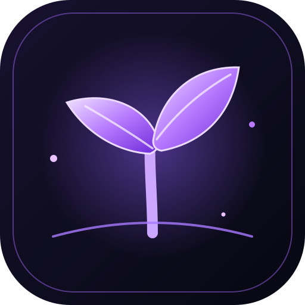

<div align="center">



# Jeden Moment

### Zatrzymaj to, co ulotne.

**Jedna dobra rzecz dziennie. Wspomnienia, do których warto wracać.**

[](https://github.com/yerdi71/moment--app)
[](#-uruchomienie)
[](https://developer.mozilla.org/docs/Web/HTML)
[](https://developer.mozilla.org/docs/Web/CSS)
[](https://developer.mozilla.org/docs/Web/JavaScript)

[**Otwórz repozytorium aplikacji**](https://github.com/yerdi71/moment--app) · [Zgłoś błąd](https://github.com/yerdi71/moment--app/issues)

</div>

---

## ✦ O projekcie

**Jeden Moment** to minimalistyczna strona promująca prywatny dziennik wdzięczności. Jej idea jest prosta: każdego dnia zatrzymać się na chwilę i zapisać jedną dobrą rzecz — nawet najmniejszą.

Nie chodzi o idealne życie ani kolejne zadanie na liście. Chodzi o zauważanie chwil, które łatwo przeoczyć, a do których po czasie chce się wrócić.

> Nie musisz mieć idealnego dnia. Wystarczy, że znajdziesz w nim jeden moment.

Ta paczka zawiera **niezależną stronę internetową**. Nie zastępuje kodu aplikacji mobilnej React Native/Expo i nie zmienia jej funkcji.

## ✨ Funkcje strony

- **Nowe logo SVG** — skalowalne, lekkie i dopasowane do identyfikacji projektu.
- **Dwa motywy** — Dark Neon oraz Soft Minimal, z zapamiętywaniem wyboru w przeglądarce.
- **Responsywny układ** — dopasowanie do telefonów, tabletów i komputerów.
- **Autorskie ikony SVG** — bez konieczności instalowania osobnej biblioteki ikon.
- **Podgląd aplikacji** — makieta ekranu telefonu osadzona w stronie.
- **Interaktywny formularz demo** — wpis do 150 znaków i wybór emocji.
- **Ogród wspomnień** — demonstracja kolejnych etapów wzrostu rośliny.
- **Rok w pikselach** — dekoracyjna wizualizacja dni.
- **Dostępność** — obsługa klawiatury i ograniczenia animacji zgodnie z ustawieniem systemowym.
- **Lekka struktura** — osobne pliki HTML, CSS i JavaScript.

## 🖼️ Kierunek wizualny

| Element | Założenie |
|---|---|
| **Styl** | Minimalistyczny, nowoczesny, spokojny |
| **Kolory** | Głęboki granat i czerń, fioletowe akcenty |
| **Typografia** | Manrope i DM Sans, z fontami systemowymi jako fallback |
| **Ikony** | SVG — ostre na każdym ekranie |
| **Animacje** | Delikatne, z uwzględnieniem `prefers-reduced-motion` |
| **Mobile** | Menu rozwijane i układ dostosowany do wąskich ekranów |

## 📁 Struktura plików

```text
jeden-moment-web/
├── index.html
├── README.md
├── assets/
│   ├── logo-icon.svg
│   └── favicon.svg
├── css/
│   └── styles.css
└── js/
    └── app.js
```

## 🚀 Uruchomienie

### Opcja 1: bez instalacji

1. Pobierz i rozpakuj paczkę ZIP.
2. Otwórz `index.html` w przeglądarce.
3. Gotowe — nie potrzebujesz Node.js ani procesu budowania.

### Opcja 2: lokalny serwer

Jeśli masz zainstalowanego Pythona, uruchom w katalogu projektu:

```bash
python -m http.server 8000
```

Następnie otwórz:

```text
http://localhost:8000
```

Lokalny serwer pozwala testować stronę w warunkach bliższych zwykłemu wdrożeniu.

## 🌍 Publikacja na GitHub Pages

1. Utwórz osobne repozytorium na stronę albo wybierz repozytorium przeznaczone do hostowania witryny.
2. Wgraj zawartość folderu projektu, zachowując strukturę `assets/`, `css/` i `js/`.
3. W repozytorium przejdź do **Settings → Pages**.
4. Wybierz źródło publikacji, np. gałąź `main` i katalog `/ (root)`.
5. Zapisz ustawienia i poczekaj na zakończenie publikacji.

> **Uwaga:** repozytorium aplikacji mobilnej `moment--app` korzysta z Expo i React Native. Nie wrzucaj plików strony do głównego katalogu aplikacji bez planu wdrożenia. Najczyściej jest utrzymywać stronę promocyjną w osobnym repozytorium.

## ⚡ Optymalizacja

- JavaScript jest ładowany z atrybutem `defer`.
- Logo i favicon są wektorowe, więc nie trzeba dostarczać wielu rozmiarów bitmap.
- Ikony interfejsu są zapisane jako SVG, bez dodatkowego pakietu.
- Elementy animowane są aktywowane przez `IntersectionObserver`, z fallbackiem dla starszych środowisk.
- Animacje są ograniczane przy włączonym systemowym ustawieniu ograniczenia ruchu.
- Formularz demo korzysta z pamięci lokalnej przeglądarki i nie wysyła wpisów na serwer.
- Wybrany motyw jest zapamiętywany lokalnie, jeśli przeglądarka na to pozwala.

## 🔐 Prywatność i ograniczenia

- Strona nie ma backendu ani systemu kont.
- Formularz demonstracyjny zapisuje tekst w `localStorage` przeglądarki.
- Wpis z demo jest niezależny od danych aplikacji mobilnej.
- Nie traktuj demonstracyjnego formularza jak bezpiecznego sejfu na poufne informacje.
- Czcionki Google są pobierane z zewnętrznego źródła; gdy są niedostępne, strona korzysta z fontów zastępczych.

## 🧰 Technologie

- HTML5
- CSS3
- JavaScript (ES2020+)
- SVG
- Intersection Observer API
- `localStorage`

Bez frameworków front-endowych i bez procesu kompilacji.

## 🗺️ Możliwe dalsze kroki

- Dodać prawdziwe zrzuty ekranu aktualnej wersji aplikacji.
- Przygotować osobne grafiki Open Graph do podglądu linków.
- Podpiąć domenę i analitykę z poszanowaniem prywatności.
- Dodać link do instalatora, gdy stabilny APK będzie faktycznie dostępny.
- Uzupełnić README o podgląd strony po jej publicznym wdrożeniu.

## 🧪 Status

**Strona promocyjna — wersja demonstracyjna.** Interakcje działają lokalnie w przeglądarce. Nie wszystkie funkcje opisywane przez projekt aplikacji mobilnej są zaimplementowane na stronie.

---

<div align="center">

**Jeden Moment**  
*Zatrzymaj to, co ulotne.*

<sub>Stworzone z myślą o małych chwilach, które zostają na dłużej.</sub>

</div>
